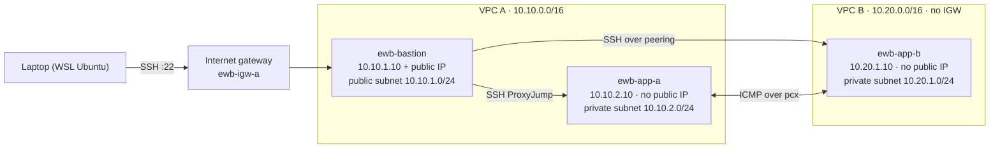

# AWS VPC Peering — Private Connectivity Between Two VPCs

Hands-on AWS networking project (EWB Courses · AWS Architect Associate · Project 01).
Two isolated VPCs connected with VPC peering so that two private EC2 instances communicate over private IPv4 addresses only, administered through a single bastion host.

| | |
|---|---|
| **Author** | Veenus Patil ([@xeevees-lab](https://github.com/xeevees-lab)) |
| **Region** | Asia Pacific (Mumbai) `ap-south-1`, AZ `ap-south-1a` |
| **Completed** | 30 October 2026 |
| **Build method** | AWS Management Console + OpenSSH (WSL Ubuntu) |
| **Status** | Built, tested, and fully cleaned up |
| **Report PDF** | [`Veenus_Patil_EWB_VPC_Peering.pdf`](Veenus_Patil_EWB_VPC_Peering.pdf) |

---

## 1. Architecture



- **One internet entry point:** only the bastion has a public IPv4 address.
- **Two private workloads:** App-A and App-B have no public IP and no internet route.
- **Administration path:** laptop → bastion → App-A / App-B using SSH `ProxyJump`. The private key never leaves the laptop.
- **Project traffic:** App-A ⇄ App-B over private IPs through peering connection `ewb-a-b-peer`.

## 2. IP plan

| Resource | Placement | IPv4 CIDR / address |
|---|---|---|
| `ewb-vpc-a` | VPC A | `10.10.0.0/16` |
| `ewb-a-public` | VPC A / public subnet | `10.10.1.0/24` |
| `ewb-a-private` | VPC A / private subnet | `10.10.2.0/24` |
| `ewb-vpc-b` | VPC B | `10.20.0.0/16` |
| `ewb-b-private` | VPC B / private subnet | `10.20.1.0/24` |
| `ewb-bastion` | `ewb-a-public` | `10.10.1.10` + public IPv4 |
| `ewb-app-a` | `ewb-a-private` | `10.10.2.10` (no public IP) |
| `ewb-app-b` | `ewb-b-private` | `10.20.1.10` (no public IP) |

**Why these CIDRs:** `10.10.0.0/16` and `10.20.0.0/16` do not overlap, which is a hard requirement for VPC peering. Every `/24` subnet sits inside its own VPC's range.

## 3. Resource inventory (actual IDs from this build)

| Resource | Name | ID |
|---|---|---|
| VPC | `ewb-vpc-a` | `vpc-097e5f66eda79859a` |
| VPC | `ewb-vpc-b` | `vpc-06ba3ceb436a7697a` |
| Subnet | `ewb-a-public` | `subnet-0267610192ceb902d` |
| Subnet | `ewb-a-private` | `subnet-0dfd432262092719f` |
| Subnet | `ewb-b-private` | `subnet-0fb0545db040f16fe` |
| Internet gateway | `ewb-igw-a` | `igw-0b9feac173d08dbcf` |
| Route table | `ewb-rt-a-public` | `rtb-0759ce7e77ded46ac` |
| Route table | `ewb-rt-a-private` | `rtb-0896b17fb64859af8` |
| Route table | `ewb-rt-b-private` | `rtb-0c9169e93fd3cc6fb` |
| Security group | `ewb-sg-bastion` | `sg-02e3c3f1ddbef4fc1` |
| Security group | `ewb-sg-app-a` | `sg-071b66f349a00ed47` |
| Security group | `ewb-sg-app-b` | `sg-0f1ace8f96a61f380` |
| Peering connection | `ewb-a-b-peer` | `pcx-09aefc23db3489877` |
| EC2 instance | `ewb-bastion` | `i-063c08bf2c3e6007c` |
| EC2 instance | `ewb-app-a` | `i-0d7f03761f1289d64` |
| EC2 instance | `ewb-app-b` | `i-042e16492750ba358` |

All instances: `t3.micro`, Amazon Linux 2023 (`ami-03765515c80e0c765`), key pair `ewb-lab`, AZ `ap-south-1a`.

## 4. Route tables

Every subnet is **explicitly** associated with its own custom route table.

**`ewb-rt-a-public`** → associated with `ewb-a-public`

| Destination | Target | Purpose |
|---|---|---|
| `10.10.0.0/16` | local | Bastion → App-A |
| `0.0.0.0/0` | `igw-0b9feac173d08dbcf` | Bastion internet access (SSH from laptop) |
| `10.20.0.0/16` | `pcx-09aefc23db3489877` | Bastion → App-B (ProxyJump hop) |

**`ewb-rt-a-private`** → associated with `ewb-a-private`

| Destination | Target | Purpose |
|---|---|---|
| `10.10.0.0/16` | local | Within VPC A |
| `10.20.0.0/16` | `pcx-09aefc23db3489877` | App-A → VPC B |

**`ewb-rt-b-private`** → associated with `ewb-b-private`

| Destination | Target | Purpose |
|---|---|---|
| `10.20.0.0/16` | local | Within VPC B |
| `10.10.0.0/16` | `pcx-09aefc23db3489877` | Return path to VPC A |

The private route tables have **no** `0.0.0.0/0` route, so App-A and App-B have no internet egress.

## 5. Security groups (inbound rules)

Outbound rules were left at the default allow-all. Default network ACLs (allow-all) were used.

| Security group | Rule ID | Type | Port | Source |
|---|---|---|---|---|
| `ewb-sg-bastion` (VPC A) | `sgr-0eacf43e71710f94f` | SSH | TCP 22 | My public IPv4 `/32` |
| `ewb-sg-app-a` (VPC A) | `sgr-040cd0935c22d4489` | SSH | TCP 22 | `10.10.1.10/32` (bastion) |
| `ewb-sg-app-a` (VPC A) | `sgr-0f30cc7a54e2f6bbd` | Custom ICMP – IPv4, Echo Request | N/A | `10.20.1.10/32` (App-B) |
| `ewb-sg-app-b` (VPC B) | `sgr-051d0498ca505ac12` | SSH | TCP 22 | `10.10.1.10/32` (bastion) |
| `ewb-sg-app-b` (VPC B) | `sgr-0c9f47e0c4c1c7a99` → re-created as `sgr-027a298197356bf0f` | Custom ICMP – IPv4, Echo Request | N/A | `10.10.2.10/32` (App-A) |

Every rule is scoped to a single host (`/32`); nothing is open to `0.0.0.0/0`.
The App-B ICMP rule has two IDs because it was deleted and re-added during the controlled-failure test (Section 7).

## 6. SSH access (no keys copied to servers)

The private key stays on the laptop at `~/.ssh/ewb-lab.pem` (`chmod 400`). The bastion is used only as a jump path. See [`config/ssh_config`](config/ssh_config).

```bash
ssh ewb-bastion   # laptop → bastion (public IP)
ssh ewb-app-a     # laptop → bastion → App-A (10.10.2.10)
ssh ewb-app-b     # laptop → bastion → peering → App-B (10.20.1.10)
```

## 7. Test results

All tests were run from inside the private hosts against **private** destination IPs.

| # | Test | Where / command | Expected | Actual result | Evidence |
|---|---|---|---|---|---|
| 01 | Baseline (before peering) | App-A: `ping -c 4 10.20.1.10` | No replies | 4 sent, 0 received, **100% loss** | [20](screenshots/20-baseline-ping-fail.png) |
| 02 | Forward path | App-A: `ping -c 4 10.20.1.10` | 0% loss | 4/4 received, **0% loss**, avg 0.273 ms | [25](screenshots/25-forward-ping-success.png) |
| 03 | Reverse path | App-B: `ping -c 4 10.10.2.10` | 0% loss | 4/4 received, **0% loss**, avg 0.244 ms | [26](screenshots/26-ssh-app-b-reverse-ping.png) |
| 04 | Private SSH | Laptop: `ssh ewb-app-b` | Shell on App-B via bastion | Prompt `ec2-user@ip-10-20-1-10` | [26](screenshots/26-ssh-app-b-reverse-ping.png) |
| 05 | Isolation | EC2 details for App-A, App-B | No public IPv4 | Public IPv4 field empty on both | [17](screenshots/17-app-a-details.png), [18](screenshots/18-app-b-details.png) |

### Controlled failure

| Step | Action | Result | Evidence |
|---|---|---|---|
| 1 | Removed **only** the ICMP Echo Request rule from `ewb-sg-app-b` (SSH rule kept) | App-B SG has 1 inbound rule | [27](screenshots/27-sg-app-b-icmp-removed.png) |
| 2 | App-A: `ping -c 4 10.20.1.10` | 4 sent, 0 received, **100% loss** | [28](screenshots/28-icmp-removed-ping-fail.png) |
| 3 | Restored the identical rule (ICMP Echo Request from `10.10.2.10/32`) | App-B SG back to 2 inbound rules | [29](screenshots/29-sg-app-b-icmp-restored.png) |
| 4 | App-A: `ping -c 4 10.20.1.10` | 4/4 received, **0% loss**, avg 0.236 ms | [30](screenshots/30-icmp-restored-ping-success.png) |

**Interpretation:** routing and peering were unchanged throughout, so the failure isolates the security group. This shows that an Active peering connection plus correct routes is not enough on its own. The destination security group must also allow the traffic.

## 8. How the traffic flows

**Forward path (App-A → App-B):** App-A (`10.10.2.10`) sends an ICMP echo request to `10.20.1.10`. The subnet's route table `ewb-rt-a-private` matches `10.20.0.0/16 → pcx-09aefc23db3489877`, so the packet crosses the peering connection into VPC B. In VPC B the local route delivers it to App-B, whose security group allows Echo Request from `10.10.2.10/32`.

**Return path (App-B → App-A):** App-B's reply to `10.10.2.10` is matched by `10.10.0.0/16 → pcx-09aefc23db3489877` in `ewb-rt-b-private`, crosses the peering connection back, and is delivered locally in VPC A. Security groups are stateful, so the reply is allowed automatically.

**SSH to App-B:** with ProxyJump, the bastion itself opens the TCP connection to `10.20.1.10:22`. That is why the public subnet's table also needs `10.20.0.0/16 → pcx`, and why App-B's SSH rule allows the bastion's private IP `10.10.1.10/32` (not the laptop's IP).

## 9. Viva questions

**1. Why is the return route needed?**
Routing is one-directional. The route in VPC A only gets packets *to* VPC B. Without `10.10.0.0/16 → pcx` in VPC B's route table, App-B's replies have no path back, so requests arrive but responses are dropped and the test still fails.

**2. Why is the App-B SSH source the bastion's private IP?**
ProxyJump does not forward the laptop's packets. The bastion opens a new TCP connection to App-B from its own interface. App-B therefore sees source `10.10.1.10`, so the rule must allow `10.10.1.10/32`. The laptop's public IP never reaches VPC B.

**3. Why does Active peering not guarantee a successful ping?**
The peering connection is only the link. Traffic also needs (a) routes in **both** VPCs' subnet route tables pointing to the `pcx`, and (b) security group rules on the destination allowing the protocol. The controlled-failure test shows this: peering stayed Active, yet removing one SG rule stopped the ping.

**4. Can VPC B use VPC A's internet gateway over peering?**
No. VPC peering does not support edge-to-edge routing. VPC B cannot use VPC A's internet gateway, NAT gateway, VPN or Direct Connect. Peering is also non-transitive: if A is peered with B and A with C, B still cannot reach C.

## 10. Cleanup

Completed after all evidence was captured:

1. Terminated `ewb-bastion`, `ewb-app-a`, `ewb-app-b` (EBS volumes deleted on termination). [33](screenshots/33-cleanup-instances-terminated.png)
2. Deleted peering connection `ewb-a-b-peer` (status *Deleted*). [32](screenshots/32-cleanup-peering-deleted.png)
3. Deleted both lab VPCs together with their subnets, custom route tables, security groups and the internet gateway. Only the account's default VPC remains. [31](screenshots/31-cleanup-vpcs.png)
4. Deleted the `ewb-lab` key pair.

No NAT gateway or Elastic IP was used.

## 11. What I learned

- A VPC peering connection is only a link. Reachability needs routes on **both** sides and matching security group rules.
- Every subnet that originates traffic to the peer needs its own route, including the bastion's public subnet when it is used as an SSH jump host.
- Security groups are stateful (replies are automatic), while routing is not (return routes must exist).
- Testing a failure on purpose is the clearest way to prove which control is responsible for allowing traffic.
- SSH ProxyJump allows administration of private instances without ever copying a private key to a server.

## 12. Repository structure

```
aws-vpc-peering-lab/
├── README.md                          ← this report
├── Veenus_Patil_EWB_VPC_Peering.pdf   ← submission report (cover, design, tests, all screenshots)
├── config/
│   └── ssh_config                     ← laptop SSH config used for ProxyJump (sanitised)
├── docs/
│   ├── architecture.png               ← architecture diagram
│   └── screenshot-index.md            ← what each screenshot proves
└── screenshots/                       ← 33 labelled console and terminal screenshots
```

Every screenshot is cropped to the relevant console area and carries a label banner with the **host / resource, step / test and result**, as the workbook requires. The key fields are boxed in red. The AWS account number and the laptop's public IP are redacted. No private key, password or access token appears anywhere in this repository.

## References

- [VPC peering concepts and limitations](https://docs.aws.amazon.com/vpc/latest/peering/what-is-vpc-peering.html)
- [Update route tables for a VPC peering connection](https://docs.aws.amazon.com/vpc/latest/peering/vpc-peering-routing.html)
- [Security groups for peered VPCs](https://docs.aws.amazon.com/vpc/latest/peering/vpc-peering-security-groups.html)
